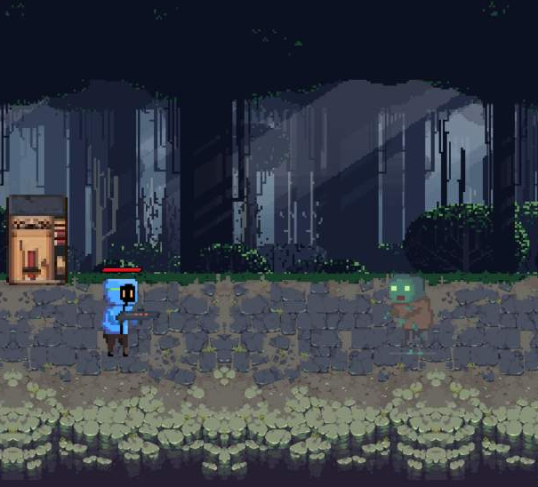

# 2.5D 橫向捲軸射擊（Pygame）

一款橫向射擊小遊戲：主角站在畫面左邊，往右邊走過來的殭屍開槍。專案從 2024 年初的一個單檔測試開始，到高三下學期整理成模組化架構。這個 repo 的 commit 歷史是照我當時留下的舊版資料夾（`old_files/`）日期重建的，可以直接看到每一版改了什麼。



▶ 成品展示影片：https://youtu.be/g2vXr7kQ7ik

## 為什麼要模組化

做[賽車遊戲](https://github.com/1142028/car-game-pygame)的時候，我發現自己的程式碼可讀性和再現性都很差：有些地方過一段時間再看，連自己都看不懂，修改或擴充也很麻煩。所以這次想透過新的遊戲專案練習模組化設計。

靈感來自 Minecraft Java 版：它靠第三方模組（mod）讓每個人都能擴充遊戲。我想做的是同一件事的縮小版：把程式拆成多個獨立模組，每個模組只負責一個功能，再由主程式把它們串起來。

## 執行方式

```bash
pip install pygame
git clone https://github.com/1142028/zombie-shooter-pygame.git "2.5D橫向捲軸射擊"
cd "2.5D橫向捲軸射擊"
python GAME.py
```

> 資料夾一定要命名成 `2.5D橫向捲軸射擊`，原因寫在下面的「已知問題」。

操作：空白鍵或點擊開始；W/A/S/D 移動（W/S 是往畫面深處走，這就是「2.5D」的部分）；E 射擊；ESC 離開。

## 版本演進

| 日期 | 變化 | 當時在想什麼 |
|---|---|---|
| 2024-01-28 | `GAME_TEST.py` 單一檔案 | 先把精靈圖（spritesheet）切格、讓角色動起來，所有東西都寫在一個 while 迴圈裡 |
| 2025-02-04 | 拆出 `modules/`（Man、Zombie、Bullet、Machine、GameStart、background） | 單檔越寫越長，改一個東西要捲半天，所以每個角色各自管自己的動畫與狀態 |
| 2025-02-12 | 新增 `State`（血條） | 原本被碰到就死，加入血量後扣血邏輯集中在 State |
| 2025-03-06 | 新增 `Enemies`，背景改由 `background` 模組處理，調整比例 | 想做多種敵人，先把敵人抽出來 |
| 2025-11-10 | 子彈碰撞改成 `Bullet.handle_bullets()`，加入殭屍血條、空白鍵開始 | 主程式裡的子彈 for 迴圈搬回 Bullet 類別，主程式只負責「呼叫」 |

## 結構

```
GAME.py              遊戲主迴圈：讀輸入、更新、繪製
modules/
  __init__.py        統一匯出各模組，主程式只要 from modules import ...
  Man.py             主角（動畫狀態：idle / walk / shoot / death）
  Zombie.py          殭屍與殭屍血條
  bullet.py          子彈與碰撞處理
  Machine.py         場景機台
  State.py           主角血量 → 血條圖片
  background.py      背景捲動
  gamestart.py       開始畫面
  Enemies.py         一般敵人（已寫好但最終版還沒接上）
resources/images/    圖片素材
```

## 遇到的問題與解法

| 問題 | 解法 |
|---|---|
| 碰撞偵測不準：角色穿牆、卡住，子彈打到敵人有時不會觸發 | 把不同功能獨立成類別，每個物件自己管理 `rect` 和狀態，互動時更直觀 |
| 物件多時 FPS 下降，載入圖片影響效能 | 有透明度的圖片一律用 `.convert_alpha()` 轉換格式，加快透明度處理 |
| 分層背景在角色移動時超出畫面，沒有銜接 | 用兩張背景圖循環播放，做到無縫接軌 |
| 一次改太多，出問題很難排查 | 拆出一個功能後，先確認它能單獨運作，再和其他模組整合 |

## 美術與素材

- 角色、殭屍、開始畫面是我用 **Pixel Studio**（手機）畫的像素圖，選像素風是因為容錯率高、方便修改和擴充動畫。
- 主選單與地面背景用**愛筆思畫**的像素化和調色功能處理。
- 森林背景來自 itch.io 的免費素材：[Free Pixel Art Forest](https://edermunizz.itch.io/free-pixel-art-forest)（作者 edermunizz）。
- 學習資源：《Python 遊戲開發講座》（碁峰），以及 [SlenderData/Dino-Rush](https://github.com/SlenderData/Dino-Rush) 的程式架構。

## 已知問題（回頭看自己的程式）

- `GAME.py` 第 56 行把資料夾名稱 `2.5D橫向捲軸射擊` 寫死在路徑裡，換資料夾名就讀不到背景。其他模組用的是相對路徑，這裡應該統一。
- `Machine.py` 讀的是 `Machine.png`，實際檔名是 `machine.png`。Windows 不分大小寫所以沒發現，在 macOS / Linux 會出錯。
- 主迴圈每一幀都 `print(state.man.health)`，是除錯時留下來的。
- 狀態判斷（例如換場景的 `space_change`）還是散落在主迴圈裡，下一步應該整理成狀態機。
- 每個 commit 都放的是最新版圖片，舊版圖片沒有保留下來，所以早期版本不一定能完整執行。
